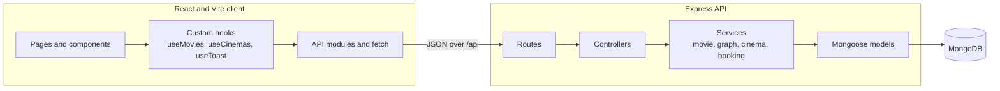
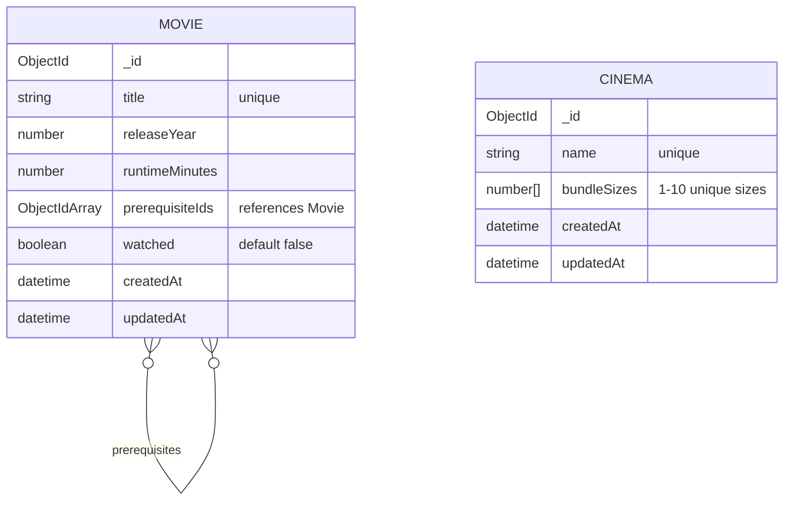

# Doomsday Ready

I built Doomsday Ready as part of the Blinto Talent Accelerator full stack developer internship assessment. It helps MCU fans prepare for *Avengers: Doomsday* by letting me record movies and their prerequisites, generate a prerequisite-first rewatch plan, track watched movies, and calculate the smallest exact set of cinema seat bundles for a watch party.

## Installation and setup

You can run the project with Docker Compose or install the client and server with npm.

### Option 1: Docker Compose

I added a Dockerfile for each app: both use Node.js 22 Alpine images, install locked dependencies with `npm ci`, and copy in their application files. In [compose.yaml](./compose.yaml), I defined the MongoDB, seed, API, and frontend services. Compose waits for MongoDB's health check before seeding and starting the API, and the MongoDB data is kept in a named volume. The seed service inserts the sample movies when the database is empty.

I have not used Docker in my other projects yet, but I know Docker fundamentals and learned them through YouTube. For this project, I asked GPT to guide me through implementing Docker Compose and explain how the containers, service dependencies, health check, and persistent volume work. I used that guidance while setting up the project.

Requirements: Docker Desktop (or Docker Engine) with Docker Compose available.

```bash
docker compose up --build
```

When the services are running, Y can open the frontend at `http://localhost:5173` and the API at `http://localhost:5000`.

### Option 2: Run with npm

You need Node.js, npm, and a running MongoDB instance. I configure `server/.env` with the database URI and optional server settings:

```env
MONGODB_URI=mongodb://localhost:27017/doomsday_ready
PORT=5000
CLIENT_URL=http://localhost:5173
```

Then I install and start the API in one terminal:

```bash
cd server
npm install
npm run dev
```

In another terminal, I set `VITE_API_BASE_URL=http://localhost:5000/api` in `client/.env`, then install and start the frontend:

```bash
cd client
npm install
npm run dev
```

## Project links

- **Source repository:** [github.com/efaaz/doomsday-ready](https://github.com/efaaz/doomsday-ready)
- **Live application:** [doomsday-ready-drab.vercel.app](https://doomsday-ready-drab.vercel.app)

## Features

- **Movies:** Create movies, choose their prerequisites, search and filter the collection, and update watched status or prerequisites.
- **Rewatch plan:** Select a target movie and get each prerequisite once, in watch order, with watched progress and unwatched runtime.
- **Cinema setup:** Add cinemas and their unique seat bundle sizes.
- **Booking quote:** For a group size, find an exact seat total using the fewest bundles, or report that no exact combination exists.

The booking feature returns a quote; it does not create or store a seat reservation.

## Technology stack

- **Frontend:** React, Vite, JavaScript, Zod, and Tailwind
- **Backend:** Node.js with Express, Mongoose, and MongoDB.
- **Backend algorithms:** Custom JavaScript graph construction and DFS for rewatch plans, plus a custom unbounded coin change algorithm using dynamic programming to find optimal booking bundles.

## Architecture

I separated the app into a React client and an Express API. The API uses controllers to handle HTTP input and output, services for validation and business logic, Mongoose models for persistence, and shared error middleware for consistent JSON errors.



The client screens are selected in `App.jsx` rather than through a routing library. I initially kept the API fetching and related state in the page components. As the pages grew, I instructed AI to move the shared movie and cinema fetching work into two custom hooks, `useMovies` and `useCinemas`. A page now destructures the data, status values, and action functions it needs from its hook instead of containing all of that request logic itself. This keeps the pages easier to read, while each page still uses `useState` for its own form inputs and local interface state. The API modules share a small `fetch` wrapper that reads `VITE_API_BASE_URL`.

On the server, the request path is:

1. Express applies JSON parsing and CORS, then ensures MongoDB is connected.
2. A route dispatches the request to a controller.
3. The controller calls a service and formats the response.
4. The service validates input, runs the domain logic, and reads or writes through a Mongoose model.
5. Errors go to one middleware that returns a JSON response with a status and error code.

I use MongoDB documents for movies and cinemas. A movie stores references to prerequisite movie IDs in the same collection. A cinema stores its allowed bundle sizes. The prerequisite references form the directed graph used by the rewatch feature.



## Feature 1: Movie dependency graph and rewatch order

I implemented the graph logic myself in `server/src/services/graph.service.js`; I do not use a graph library. The service builds an adjacency graph with a JavaScript `Map`, where each movie ID maps to the IDs of the movies that must be watched first. A second map provides quick access from an ID to the full movie data.

I chose depth-first search (DFS) after focusing on the requirement that every prerequisite must appear before the movie that depends on it. I thought of this as a backtracking problem: visit prerequisites recursively, then add each movie to the result as the search unwinds. This post-order traversal naturally gives me a prerequisite-first order. A `visited` set ensures a movie shared by multiple dependency paths appears only once, and I leave the target itself out of the returned list.

I also track the current recursion path in `pathVisited`. If DFS reaches a movie already on that path, the dependencies contain a cycle. I validate the complete candidate graph before saving a movie create or update, so a change that creates a circular dependency is rejected with HTTP `409` and code `CIRCULAR_DEPENDENCY`. The rewatch-plan service then counts watched prerequisites and sums the runtime of the unwatched ones.

I chose DFS because one traversal gives me the reachable prerequisite set, a valid prerequisite-first ordering, and cycle detection using the active search path. Its traversal is **O(V + E)** in the size of the graph, where `V` is the number of movies and `E` is the number of prerequisite links.

## Feature 2: Minimum-bundle booking with dynamic programming

I implemented the booking algorithm myself in `server/src/services/booking.service.js`, without a coin-change or optimization library. A cinema's bundle sizes act like coin denominations, and the group size is the target amount. The goal is to make the target exactly while minimizing the number of bundles; bundle sizes may be reused without limit.

I first considered a greedy approach that always picks the largest bundle that fits. Greedy choices can miss the optimal answer: with bundle sizes `[1, 3, 4]` and a group of `6`, greedy picks `4 + 1 + 1` (three bundles), while the best answer is `3 + 3` (two bundles). I therefore use bottom-up dynamic programming to compare every allowed bundle for every amount:

```text
dp[0] = 0
dp[amount] = min(dp[amount - size] + 1) for each size <= amount
```

The `dp` array stores the fewest bundles for each exact seat total. I keep a parallel `choice` array to remember which bundle size produced the best result, then follow those choices backward to count the bundles. If the target remains unreachable, the service returns `possible: false`. This takes **O(G × B)** time and **O(G)** space, where `G` is the group size and `B` is the number of available bundle sizes.

For example, bundle sizes `[2, 5]` and a group of `11` produce four bundles: one 5-seat bundle and three 2-seat bundles.

## Frontend and AI use

I used AI to help design the frontend and build React components. I first had API requests and their state in the page components, then instructed AI to organize the repeated movie and cinema fetching work into the two custom hooks. Those hooks expose the fetched data, loading and saving indicators, and action functions for pages to destructure and use. I keep form-specific state, such as field values, filters, and the selected view, in `useState` where it is used. This split reduces the amount of request and mutation logic in each page and makes the components easier to read. `useToast` shares notifications through a provider. I used Zod schemas for client-side form validation, while the server validates requests again before applying business logic.

The brief describes the Movies, Rewatch Plan, and Booking views. I added a separate Add Cinema page because creating cinemas and configuring their seat bundles is an administrator/setup task, while a regular customer uses those configured cinemas to request a booking quote. This is a workflow separation in the UI; I have not added login or role-based access control. The interface therefore has four views: Movies, Rewatch Plan, Booking, and Add Cinema. The movie view includes search and watched-status filters; the rewatch view refreshes progress after a watched toggle; the booking view shows either a bundle breakdown or why an exact match is unavailable. I kept the graph and optimization algorithms in the backend service code.

I did not add React Router because this small app only needs simple view switching. `App.jsx` keeps the active view in React state, starting at Movies. Since the selected page is not stored in the URL or persistent storage, reloading the browser resets the app to the Movies page.

## API

All application endpoints are JSON under `/api`.

| Method | Endpoint | Purpose |
| --- | --- | --- |
| `POST` | `/api/movies` | Create a movie |
| `GET` | `/api/movies` | List movies |
| `PATCH` | `/api/movies/:id` | Update movie details, watched status, or prerequisites |
| `GET` | `/api/movies/:id/rewatch-order` | Get prerequisite movies and the plan summary |
| `POST` | `/api/cinemas` | Create a cinema with bundle sizes |
| `GET` | `/api/cinemas` | List cinemas |
| `GET` | `/api/cinemas/:id/booking?groupSize=6` | Calculate a minimum exact-bundle quote |
| `GET` | `/` | API health response |

Example request bodies:

```json
{
  "title": "Avengers: Endgame",
  "releaseYear": 2019,
  "runtimeMinutes": 181,
  "prerequisiteIds": [],
  "watched": false
}
```

```json
{
  "name": "Central Cinema",
  "bundleSizes": [2, 5]
}
```

The rewatch response includes the target movie, the ordered prerequisite movies, and a summary with `totalMovies`, `watchedMovies`, `remainingMovies`, and `remainingRuntimeMinutes`. A booking response includes `possible`, `groupSize`, `totalBundles`, and the quantity of each bundle size when a match exists.

The client project also provides `npm run build` and `npm run lint`. The repository has small manual algorithm examples in `server/src/testing/test-graph.js` and `server/src/testing/test-booking.js`; the root and server `npm test` scripts are placeholders, and there is no configured automated test suite.

## Validation rules

- Movie titles and cinema names must be unique.
- Movie runtime must be an integer from 1 to 300 minutes. The frontend form currently limits release years to 1900–2100; the backend requires a positive integer.
- Prerequisite IDs must refer to existing movies, cannot be duplicated, and cannot create a cycle.
- Each cinema must have 1–10 unique integer bundle sizes, each from 1 to 500 seats.
- Booking group size must be an integer from 1 to 10,000.

I store configuration such as `MONGODB_URI` in local environment files and do not include those values in this README.
